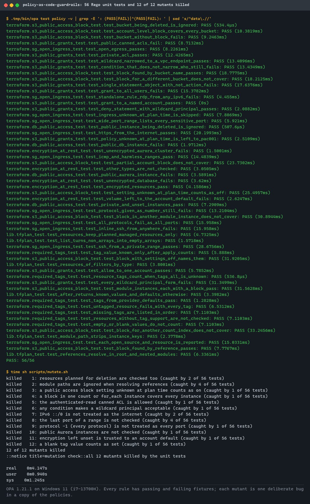
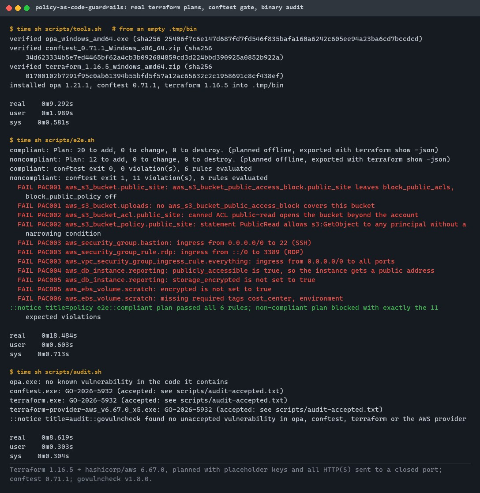
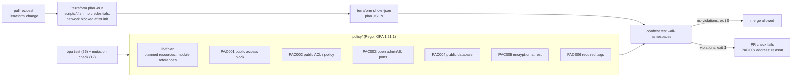
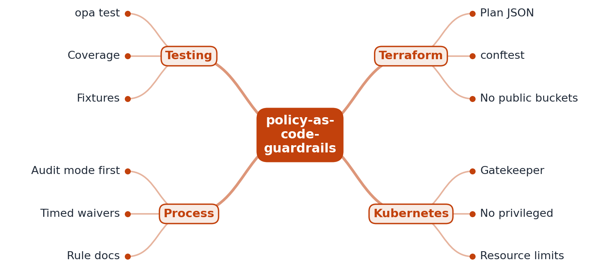

# policy-as-code-guardrails

[](https://github.com/EquinoxWN/policy-as-code-guardrails/actions/workflows/ci.yml)


> Stops the mistakes that cause breaches (public buckets, open ports) before they merge: six Rego rules, each tested with passing and failing fixtures, enforced by conftest on real `terraform show -json` plans in CI.

Part of my **DevOps and Cloud** list · Rego · Terraform

## Proof it works

56 unit tests pass, and a mutation check shows they catch all 12 deliberate bugs planted in copies of the rules:



Two example stacks are planned for real with Terraform and the AWS provider, without credentials and with the network blocked. conftest passes the compliant plan (20 resources, 0 violations) and blocks the non-compliant one with exactly the 11 expected messages. Every tool binary is checksum-verified and scanned for known vulnerabilities:



## Architecture

**What M1 runs today:**



**Full roadmap (M1 to M3):**



## How it works

_Steps 1 and 2 run in M1, and every rule already has unit tests with passing and failing fixtures (the first half of step 4). Coverage, Gatekeeper and the rest are on the [roadmap](#roadmap)._

1. Rules are written in Rego: no public buckets, no SSH open to 0.0.0.0/0, required tags, and so on.
2. In CI, `terraform plan` is exported as JSON and conftest evaluates it, failing the PR on violations.
3. In the cluster, Gatekeeper blocks privileged pods and workloads without resource limits.
4. Every policy has unit tests with passing and failing fixtures, and coverage is reported.
5. New rules start in audit mode; exceptions use annotated, time-limited waivers.
6. Each rule's documentation explains the risk it prevents.

The six M1 rules, all on the plan JSON of the hashicorp/aws provider:

| ID | Rule | Checks | Unknown at plan time |
|---|---|---|---|
| PAC001 | Every S3 bucket has a full public access block | `aws_s3_bucket_public_access_block` with all four settings on, matched to the bucket by name or by reference in the same module instance and `count`/`for_each` key; or an `aws_s3_account_public_access_block` with all four on | Counts as off |
| PAC002 | No S3 ACL or bucket policy grants access to everyone | Canned ACLs `public-read`, `public-read-write`, `authenticated-read`; grants to AllUsers/AuthenticatedUsers; Allow statements for `*` without a condition on a narrowing key (`aws:SourceVpce`, `aws:PrincipalOrgID`, ...) | Skipped; PAC001's `block_public_policy` makes AWS refuse a public policy |
| PAC003 | No admin or database port open to the internet | Ingress from any `/0` (0.0.0.0/0, ::/0) to SSH, Telnet, RDP, VNC, SQL Server, Oracle, MySQL, PostgreSQL, Redis, MongoDB, Elasticsearch, the Docker API, or to every port; inline rules, `aws_security_group_rule` and `aws_vpc_security_group_ingress_rule` | Skipped |
| PAC004 | No publicly accessible database instance | `publicly_accessible = true` on `aws_db_instance` and `aws_rds_cluster_instance` | Treated as false (the provider default) |
| PAC005 | Databases and volumes encrypted at rest | `storage_encrypted` on `aws_db_instance` and `aws_rds_cluster`, `encrypted` on `aws_ebs_volume` must be `true` | Counts as unencrypted |
| PAC006 | Required tags | `owner`, `environment`, `cost_center` non-empty on every resource with `tags_all`, so `default_tags` count | A value known only after apply counts |

Each message starts with the rule ID and the resource address, for example `PAC003 aws_security_group.bastion: ingress from 0.0.0.0/0 to 22 (SSH)`. Resources being deleted and data sources are never checked.

## Who it helps

- **Who:** platform and security engineers who look after a team's Terraform on AWS, and the application developers who write it.
- **The problem:** a public bucket, SSH or a database port open to the internet, or an unencrypted database can pass code review in a long plan, especially when the value comes from a module or provider defaults.
- **How to use it:** in your pipeline, run `terraform plan -out plan.tfplan`, `terraform show -json plan.tfplan > plan.json`, then `conftest test --all-namespaces --policy policy plan.json` (or `make check PLAN=plan.json`). A violation fails the job with the rule ID, the resource address and the reason.
- **How to extend it:** add a package under `policy/terraform/<rule>/` with a `deny` rule and a `_test.rego` file with passing and failing fixtures; `make test mutate e2e` shows whether it works on unit fixtures and on real plans.

## Tech stack

| Area | In M1 | Planned |
|---|---|---|
| Rules | OPA Rego (v1 syntax), six rules on Terraform plan JSON, a shared `lib/tfplan` library | Gatekeeper constraint templates for Kubernetes (M2) |
| Enforcement | conftest 0.71.1 in GitHub Actions on real plans from Terraform 1.16.5 and hashicorp/aws 6.67.0 | Audit mode and time-limited waivers (M3) |
| Testing | `opa test` (56 tests, passing and failing fixtures), a 12-mutant mutation check, an end-to-end check with an exact expected-violations list | Coverage report (M2) |
| Supply chain | Tools pinned by version and SHA-256, govulncheck binary audit with an explicit accepted list, actions pinned by SHA | - |

Languages: **Rego** and **HCL** (examples), with POSIX shell scripts. The rules are in [`policy/terraform/`](policy/terraform) with their tests beside them, the shared plan helpers in [`policy/lib/tfplan`](policy/lib/tfplan), test builders in [`policy/lib/fixtures`](policy/lib/fixtures), the example stacks in [`examples/`](examples), and the scripts in [`scripts/`](scripts).

## Run it

**Prerequisites:** `make`, a POSIX shell, `curl`, `unzip` and `tar` (Linux, or Git Bash on Windows; amd64). Go 1.26 only for `make audit`. No cloud account: `make setup` downloads OPA, conftest and Terraform into `.tmp/bin` and checks each against the SHA-256 pinned in `scripts/tools.sh` and the checksum file published with the release.

```bash
make setup    # pinned OPA 1.21.1, conftest 0.71.1, Terraform 1.16.5 into .tmp/bin, checksum-verified
make lint     # opa fmt --fail, opa check --strict, terraform fmt -check
make test     # opa test: 56 unit tests
make mutate   # 12 deliberate bugs in copies of the policies; the tests must catch each one
make e2e      # plan both examples offline, terraform show -json, conftest; exact expected violations
make audit    # govulncheck on opa, conftest, terraform and the AWS provider (after make e2e)
make check PLAN=path/to/plan.json   # evaluate your own plan
```

`scripts/tf.sh` is the only way Terraform runs here. It refuses `apply`, `destroy`, `import` and state commands, clears every AWS credential source, keeps Terraform's config, plugin cache and data directory in `.tmp/tf`, and sends all HTTP(S) after `init` to a closed local port, so a successful plan proves no AWS API was called. `make e2e` downloads the AWS provider once (about 800 MB unpacked).

## Tests and results

Full commands, every test name, the mutants and the DMAIC analysis: [docs/results/m1.md](docs/results/m1.md). Measured on Windows 11 (i7-13700H); the full check ran twice with the same results.

| Test file | Tests | What it proves |
|---|---|---|
| [`policy/lib/tfplan/tfplan_test.rego`](policy/lib/tfplan/tfplan_test.rego) | 6 | Deletions and data sources are skipped; defaults for null or unknown values; module instance keys stripped; references resolved in root and nested modules |
| [`s3_public_access_block_test.rego`](policy/terraform/s3_public_access_block/s3_public_access_block_test.rego) (PAC001) | 12 | 5 passing fixtures (by reference, by name, account-level, deleted bucket, `for_each` modules), 7 failing (no block, settings off, unknown setting, other module instance, other `count` index, partial account block, other bucket) |
| [`s3_public_grants_test.rego`](policy/terraform/s3_public_grants/s3_public_grants_test.rego) (PAC002) | 11 | 6 passing (private ACL, named grantee, Deny with `*`, one account, VPC-endpoint condition, unknown policy), 5 failing (3 public canned ACLs, AllUsers grant, 3 wildcard principal forms, non-narrowing condition, `NotAction`) |
| [`sg_open_ingress_test.rego`](policy/terraform/sg_open_ingress/sg_open_ingress_test.rego) (PAC003) | 11 | 5 passing (web ports, private SSH, egress, ICMP and harmless ranges, unknown rules), 6 failing (inline SSH, RDP from `::/0`, protocol `-1`, wide range, protocol `"6"`, several sources) |
| [`db_public_access_test.rego`](policy/terraform/db_public_access/db_public_access_test.rego) (PAC004) | 4 | 2 passing (private or unset, deleted), 2 failing (RDS and Aurora instances) |
| [`encryption_at_rest_test.rego`](policy/terraform/encryption_at_rest/encryption_at_rest_test.rego) (PAC005) | 5 | 2 passing, 3 failing (RDS, Aurora cluster, volume left unset) |
| [`required_tags_test.rego`](policy/terraform/required_tags/required_tags_test.rego) (PAC006) | 7 | 4 passing (`default_tags`, values known after apply, unknown `tags_all`, no tag support), 3 failing (missing, blank, untagged) |
| [`scripts/mutate.sh`](scripts/mutate.sh) | 12 mutants | Every deliberate rule bug makes at least one unit test fail |
| [`scripts/e2e.sh`](scripts/e2e.sh) | 2 real plans | Compliant plan: exit 0, 0 violations; non-compliant plan: exit 1, exactly the 11 lines of [`expected-violations.txt`](examples/noncompliant/expected-violations.txt); all 6 rule packages evaluated |

| Check | Result |
|---|---|
| Unit tests (`make test`) | **56 passed**, 0 failed, 0.13 s |
| Mutation check (`make mutate`) | **12 of 12** mutants killed, 4.1 to 4.7 s |
| End to end (`make e2e`) | compliant plan (20 resources): **0 violations**; non-compliant plan (12 resources): **11 of 11 expected violations**, nothing else; 18.5 to 18.9 s |
| Does the gate catch a broken rule? | With PAC003 changed to ignore `::/0`, `make e2e` failed and showed the missing RDP line |
| Cloud access | 0 AWS API calls (placeholder keys, network blocked after `init`); nothing applied |
| Lint | `opa fmt --fail`, `opa check --strict`, `terraform fmt -check`: clean. Regal 0.43.0 run once: 37 findings, all fixed |
| Supply chain | 3 of 3 tool downloads match the pinned and published SHA-256; govulncheck: no unaccepted finding in opa, conftest, terraform or the AWS provider (GO-2026-5932, no fix released, accepted with a reason) |

## Roadmap

**M1** (≈8 h)
- [x] Write `docs/rfc/0001-design.md`: problem, goals, non-goals, chosen design
- [x] Rules are written in Rego: no public buckets, no SSH open to 0.0.0.0/0, required tags, and so on.
- [x] In CI, `terraform plan` is exported as JSON and conftest evaluates it, failing the PR on violations.

**M2** (≈8 h)
- [ ] In the cluster, Gatekeeper blocks privileged pods and workloads without resource limits.
- [ ] Every policy has unit tests with passing and failing fixtures, and coverage is reported. _(Fixtures exist for all six M1 rules; the coverage report is still to do.)_

**M3** (≈9 h)
- [ ] New rules start in audit mode; exceptions use annotated, time-limited waivers.
- [ ] Each rule's documentation explains the risk it prevents.
- [ ] Publish the proof below with real numbers

## Proof

What this repo must show before it counts as done:

- Policy coverage report and a PR blocked by a failing rule.

| Result | Value |
|---|---|
| Policy coverage report | Not measured yet (M2) |
| A PR blocked by a failing rule | Not published yet (M3). In M1 the same gate blocks the non-compliant example plan in CI; see [Tests and results](#tests-and-results). |

## Why it matters

- **Interview angle:** 'Enforce standards across teams without blocking them'.
- **Upstream I'm contributing to:** Open Policy Agent or Gatekeeper.

## Design docs

- [RFC 0001: design](docs/rfc/0001-design.md)
- [ADR 0001: record architecture decisions](docs/adr/0001-record-architecture-decisions.md)
- [ADR 0002: own rules in Rego, evaluated on plan JSON with conftest](docs/adr/0002-rego-on-plan-json-with-conftest.md)
- [ADR 0003: real plans offline, with placeholder credentials and no network](docs/adr/0003-offline-plans-with-placeholder-credentials.md)
- [ADR 0004: pinned tool binaries, a binary vulnerability audit, and no Regal in CI](docs/adr/0004-pinned-tool-binaries-and-audit.md)
- [M1 results](docs/results/m1.md)

## Scope

This is a learning and portfolio system, not a hosted production service. Everything runs locally. The policies and example configurations are inert: they are planned, never applied, and nothing in this repository deploys anything.

## Security and contributing

- Every GitHub Action is pinned to a commit SHA; the workflow runs read-only, without persisted credentials and without cloud credentials.
- OPA, conftest and Terraform are pinned by version and SHA-256 for Linux and Windows; the AWS provider is pinned by the committed lock files; Dependabot update pull requests are paused (`open-pull-requests-limit: 0`) so the repository keeps a single `main` branch; dependencies are updated by hand and checked by the CI audit.
- CI runs `govulncheck` on every tool and provider binary; findings fail the build unless listed with a reason in [`scripts/audit-accepted.txt`](scripts/audit-accepted.txt).
- Report vulnerabilities privately: see [SECURITY.md](SECURITY.md). To contribute, see [CONTRIBUTING.md](CONTRIBUTING.md).

## License

MIT, see [LICENSE](LICENSE).
